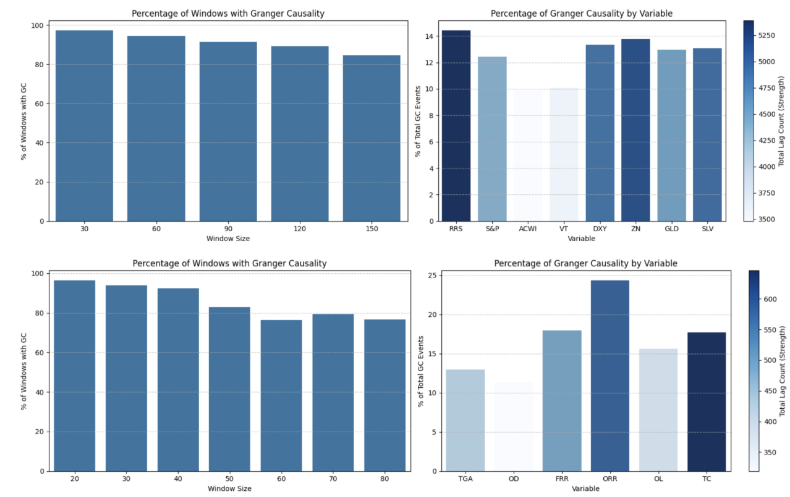
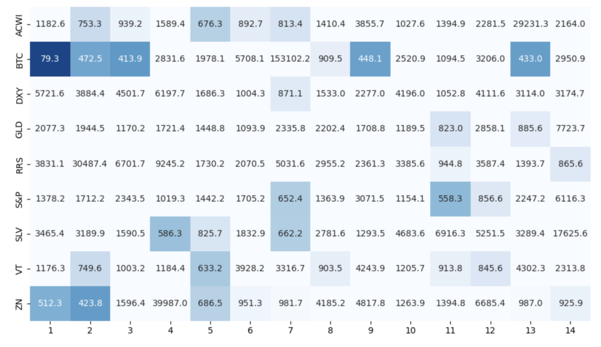
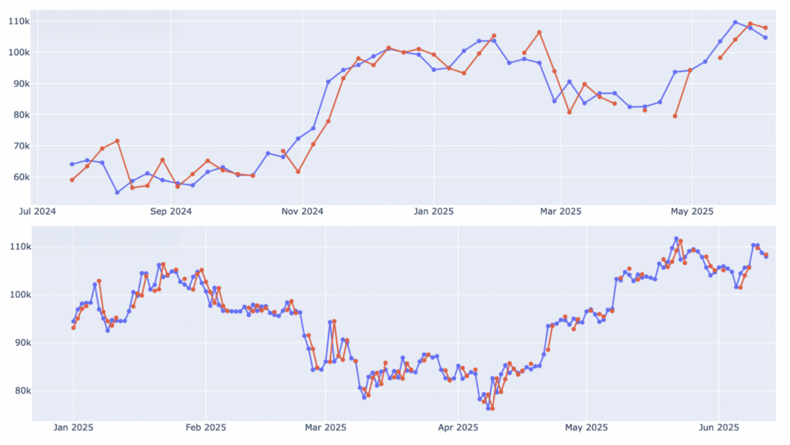
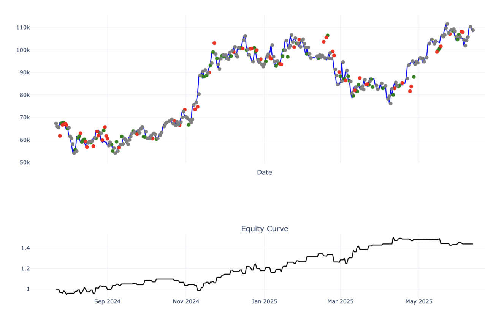

# Bitcoin & Global Liquidity — Diploma Thesis Research

Research code and selected empirical outputs from my diploma thesis, **“Cryptocurrency Prediction by Means of Macroeconomic Analysis”**, completed in Electrical and Computer Engineering at Aristotle University of Thessaloniki (AUTh). The thesis received **10/10**.

The project asks a deliberately difficult question: **do global-liquidity and cross-asset macro variables contain stable, usable information about Bitcoin?** I tested that question with rolling Granger-causality analysis, VAR/VECM models, sparse lag selection with modified Backward-in-Time Selection (mBTS), one-step forecasting, and a persistence benchmark.

The central result is negative and important: **transient causal relationships appear, but the linear forecasting models did not systematically outperform a simple persistence/random-walk benchmark.** The repository therefore presents the work as an econometric research study, not as evidence of persistent alpha.

## Research pipeline

1. Build daily and weekly datasets combining Bitcoin with liquidity and macro proxies.
2. Test stationarity / cointegration and study rolling Granger-causal relationships.
3. Estimate multivariate VAR/VECM models under changing window and lag specifications.
4. Apply **mBTS** to select variable-specific lags with a BIC-based procedure.
5. Examine whether selected relationships remain stable across window sizes and lags.
6. Produce one-step-ahead forecasts from shrinking historical samples and combine candidate forecasts using inverse-nRMSE weights.
7. Compare forecast error with a naive persistence model.
8. As an exploratory practical exercise, convert forecasts into one-day directional signals using a ±0.5% threshold.

> **mBTS is a published lag-selection methodology; it was applied in this thesis, not invented here.** The `src/` version is a cleaned research implementation based on the notebook logic.

## Selected empirical results

### 1. Rolling mBTS causality structure



The left panels ask a simple question: **in what percentage of rolling windows did mBTS retain at least one external variable for predicting BTC?** The right panels show which variables appeared in those selected relationships and use color intensity to summarize total selected-lag count.

The thesis found that the sparse mBTS specification was more stable across parameter choices than the conventional VAR/VECM Granger results. That does **not** imply superior forecasts; it only suggests that some lag structures recurred more consistently.

### 2. Stability of lag coefficients



A separate diagnostic examined coefficient dispersion across rolling windows and lag orders. Darker cells represent lower standard deviation relative to the mean coefficient and therefore comparatively more stable estimated effects. This was used as an additional filter: statistical significance alone was not treated as sufficient evidence of a durable relationship.

### 3. One-step mBTS forecasts



Daily and weekly mBTS forecasts can visually track portions of the Bitcoin path. The benchmark result matters more than visual fit: across the tested shrinking-window configurations, **mBTS did not achieve lower normalized forecast error than persistence**. VAR/VECM produced the same broad conclusion.

I deliberately did not continue tuning window counts or lag limits simply to improve historical nRMSE, because that would increase the risk of overfitting without evidence of future generalization.

### 4. Exploratory directional application



The practical exercise translated the combined forecast into a one-day rule:

- forecast > current price by **+0.5%** → long;
- forecast <= current price by **-0.5%** → short;
- forecast inside **±0.5%** → no position.

In the thesis sample this produced **122 trades**, **55% winners**, an **average-profit / average-loss ratio of 1.2**, and ending capital of **1.45×**. Buy-and-hold over the same comparison period reached **1.6×**.

These figures are retained as an exploratory historical result. They were **not** treated as repeatable or as proof of a profitable trading strategy.

## Additional VAR/VECM diagnostic

The conventional rolling Granger results were materially more sensitive to window length and lag specification. The supporting heatmap is retained here for contrast:


## Repository structure

```text
src/
  granger.py       rolling pairwise Granger-causality analysis
  mbts.py          cleaned sparse lag-selection implementation
  analysis.py      rolling mBTS summaries and coefficient-stability diagnostic
  forecasting.py   nRMSE, persistence benchmark, shrinking-window combination
  trading.py       exploratory ±0.5% directional rule
examples/
  synthetic_smoke.py
docs/figures/
  selected figures from the original thesis experiments
```

The large exploratory notebooks are intentionally not the public interface of this repository. They mixed data acquisition, experimentation, plotting, and repeated model variants. `src/` isolates the methods that are easiest to inspect and discuss.

## Methodological notes

- Granger causality means **incremental temporal predictive information**, not structural/economic causation.
- Rolling results are parameter-sensitive; window length and lag specification materially change conventional VAR/VECM findings.
- Forecasts were assessed against a persistence/random-walk baseline rather than judged from visual fit alone.
- Cross-window or in-sample weighting is not automatically out-of-sample evidence.
- The trading-rule figure is an exploratory application and omits any claim of repeatability.
- Further parameter fitting was intentionally limited when it risked becoming historical curve-fitting.

## Reproducibility

The original empirical study depended on historical datasets assembled for the thesis. Those datasets are not redistributed here. The committed figures are **historical research outputs** from the thesis; the small `examples/synthetic_smoke.py` script exists only to verify that the cleaned public utilities execute in a fresh environment.

```bash
python -m pip install -r requirements.txt
python examples/synthetic_smoke.py
```

## Thesis conclusion

The evidence supported a restrained conclusion: macro/liquidity variables sometimes contained statistically detectable information about Bitcoin, and sparse lag selection revealed recurring relationships, but **exact price prediction remained extremely difficult and the linear models did not systematically beat persistence**. Future work is therefore better framed around directional information, regime context, and non-linear relationships than around confident point forecasts.
